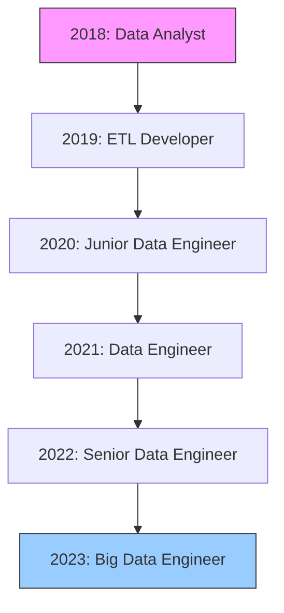

👋 Hey, I'm Taghred Salah Ashry

Data Engineer | ETL Developer | Big Data Engineer
Building scalable data solutions for real-time insights

---

📞 Contact & Connect

  
  
  
  

---

🚀 About Me

I'm a passionate Data Engineer with expertise in designing and implementing scalable data pipelines and ETL/ELT processes. My focus is on building robust, cost-efficient data infrastructure that enables data-driven decision making and business intelligence.

"Turning raw data into actionable insights through elegant engineering solutions."

📊 Current Focus

· 🔭 Working on: Building real-time data pipelines with Apache Spark & Kafka
· 🌱 Learning: Advanced streaming architectures & cloud-native data platforms
· 💡 Interested in: Data mesh architecture & MLops
· 🎯 Goal: Contributing to open-source data engineering projects

---

🛠️ Tech Stack

Programming & Query Languages

https://img.shields.io/badge/Python-3776AB?style=flat-square&logo=python&logoColor=white
https://img.shields.io/badge/Java-ED8B00?style=flat-square&logo=openjdk&logoColor=white
https://img.shields.io/badge/Scala-DC322F?style=flat-square&logo=scala&logoColor=white
https://img.shields.io/badge/SQL-4479A1?style=flat-square&logo=postgresql&logoColor=white
https://img.shields.io/badge/Bash-4EAA25?style=flat-square&logo=gnu-bash&logoColor=white

Big Data & Processing

https://img.shields.io/badge/Apache_Spark-E25A1C?style=flat-square&logo=apachespark&logoColor=white
https://img.shields.io/badge/Apache_Kafka-231F20?style=flat-square&logo=apache-kafka&logoColor=white
https://img.shields.io/badge/Apache_Airflow-017CEE?style=flat-square&logo=apache-airflow&logoColor=white
https://img.shields.io/badge/Hadoop-66CCFF?style=flat-square&logo=apache-hadoop&logoColor=white

Databases & Data Warehouses

https://img.shields.io/badge/PostgreSQL-4169E1?style=flat-square&logo=postgresql&logoColor=white
https://img.shields.io/badge/MySQL-4479A1?style=flat-square&logo=mysql&logoColor=white
https://img.shields.io/badge/Oracle-F80000?style=flat-square&logo=oracle&logoColor=white
https://img.shields.io/badge/Snowflake-29B5E8?style=flat-square&logo=snowflake&logoColor=white
https://img.shields.io/badge/Amazon_Redshift-8C4FFF?style=flat-square&logo=amazon-redshift&logoColor=white
https://img.shields.io/badge/MongoDB-47A248?style=flat-square&logo=mongodb&logoColor=white

Cloud Platforms

https://img.shields.io/badge/AWS-232F3E?style=flat-square&logo=amazon-aws&logoColor=white
https://img.shields.io/badge/Azure-0078D4?style=flat-square&logo=microsoft-azure&logoColor=white
https://img.shields.io/badge/GCP-4285F4?style=flat-square&logo=google-cloud&logoColor=white

Data Tools & DevOps

https://img.shields.io/badge/dbt-FF694B?style=flat-square&logo=dbt&logoColor=white
https://img.shields.io/badge/Docker-2496ED?style=flat-square&logo=docker&logoColor=white
https://img.shields.io/badge/Kubernetes-326CE5?style=flat-square&logo=kubernetes&logoColor=white
https://img.shields.io/badge/Git-F05032?style=flat-square&logo=git&logoColor=white
https://img.shields.io/badge/Terraform-7B42BC?style=flat-square&logo=terraform&logoColor=white
https://img.shields.io/badge/Linux-FCC624?style=flat-square&logo=linux&logoColor=black

---

📈 GitHub Stats

https://github-readme-stats.vercel.app/api?username=taghredsalah&show_icons=true&theme=radical&hide_border=true&count_private=true
https://github-readme-stats.vercel.app/api/top-langs/?username=taghredsalah&layout=compact&theme=radical&hide_border=true
https://github-readme-streak-stats.herokuapp.com/?user=taghredsalah&theme=radical&hide_border=true

---

🏗️ Projects

Featured Projects

Project Description Tech Stack
Real-time ETL Pipeline Kafka-Spark streaming pipeline for clickstream data Spark, Kafka, Python, Airflow
Data Warehouse Migration Migrating on-premise DW to cloud (Snowflake) Snowflake, dbt, Airflow, Python
ML Feature Store Feature engineering platform for ML models Feast, Spark, PostgreSQL
Data Quality Framework Automated data quality checks & monitoring Great Expectations, Airflow, Python

View all projects on my GitHub Profile

---

📝 Latest Blog Posts

<!-- BLOG-POST-LIST:START -->

· Building Real-time Data Pipelines with Apache Spark & Kafka
· Cost Optimization Strategies for Big Data Platforms
· Implementing Data Mesh: Lessons Learned

<!-- BLOG-POST-LIST:END -->

---

🏆 Certifications

https://img.shields.io/badge/AWS_Certified_Data_Analytics-FF9900?style=for-the-badge&logo=amazon-aws&logoColor=white
https://img.shields.io/badge/Azure_Data_Engineer-0078D4?style=for-the-badge&logo=microsoft-azure&logoColor=white
https://img.shields.io/badge/Apache_Spark_Developer-E25A1C?style=for-the-badge&logo=apache-spark&logoColor=white

---

📊 Experience Timeline

---

🎯 What I Bring to the Table

Core Competencies

· ✅ Data Pipeline Development: Design & implementation of batch/streaming pipelines
· ✅ Cloud Data Platforms: AWS, Azure, GCP deployment & optimization
· ✅ Big Data Processing: Spark, Hadoop, distributed computing
· ✅ Data Warehousing: Snowflake, Redshift, BigQuery architectures
· ✅ Data Quality & Governance: Implementing data quality frameworks
· ✅ Infrastructure as Code: Terraform, CloudFormation, CI/CD pipelines

Industry Experience

· E-commerce: Real-time recommendation systems
· FinTech: Fraud detection & transaction monitoring
· Healthcare: Patient data analytics & HIPAA compliance
· IoT: Sensor data processing & time-series analysis

---

🤝 Open to Collaborate On

· Open-source data engineering tools
· Data pipeline optimization projects
· Cloud migration initiatives
· Data quality frameworks
· Educational content for aspiring data engineers

---

📫 Let's Connect!

https://img.shields.io/badge/Email-taghred.ashry@gmail.com-blue?style=flat-square&logo=gmail
https://img.shields.io/badge/Schedule_Call-30_min-C1A875?style=flat-square&logo=google-calendar

"Data is the new oil, and pipelines are the refineries that make it valuable."

⭐ Feel free to star my repositories if you find them useful!

https://komarev.com/ghpvc/?username=taghredsalah&color=blue&style=flat-square

